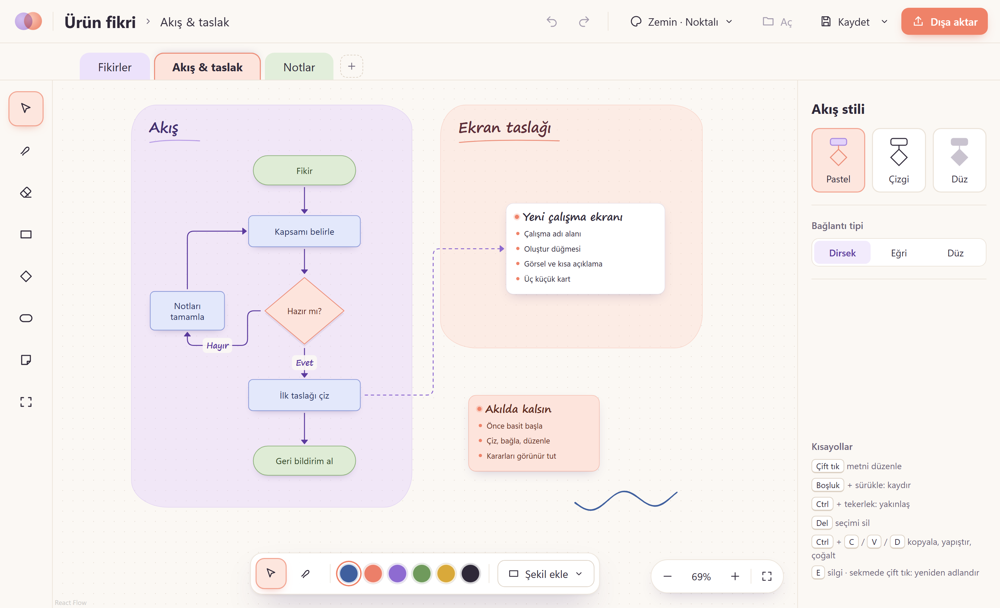

<p align="center">
  
</p>

<p align="center">
  <a href="LICENSE"></a>
  
  
  
  
  
</p>

<p align="center">
  <b>Think on one board — notes, flows, regions, sketches and pictures — and let your AI read and edit the same board, safely.</b>
</p>

<p align="center">
  <a href="#-what-you-get">Features</a> ·
  <a href="#%EF%B8%8F-a-look-at-the-app">Screenshot</a> ·
  <a href="#-work-with-your-ai">AI over MCP</a> ·
  <a href="#-example-session">Example</a> ·
  <a href="#%EF%B8%8F-safe-ai-edits">Safety</a> ·
  <a href="#-one-file-per-workspace">File format</a> ·
  <a href="#-quick-start">Quick start</a> ·
  <a href="#-mcp-tools">Tools</a> ·
  <a href="#%EF%B8%8F-shortcuts">Shortcuts</a>
</p>

<p align="center">
  
</p>

## 🎨 One board for the whole thought

Raelin is a desktop canvas for the messy middle of a piece of work: the brainstorm, the flow you are not sure about yet, the notes from a meeting, the screen you want to sketch. Everything sits on one board, in pastel regions you can move around as a whole.

> **Your AI works on the same board as you.** Ask Claude Code, Codex or Claude Desktop to sketch a flow, tidy a region or sum up your notes: the change appears live, and one **Ctrl+Z** takes it back.

- ✍️ **Free-form first**: drop a note, a flow step or a pen stroke anywhere; structure comes when you want it.
- 🧭 **Flows that stay readable**: start/process/decision shapes, labelled connections, references that are not flow order, and one-click auto layout.
- 🤖 **AI as a colleague, not a black box**: it reads what it needs, writes in small checked batches, and every change is labelled and undoable.
- 💾 **Plain local files**: one `.rli` file per workspace, stable JSON you can diff, no account and no cloud.

## ✨ What you get

- 📝 **Notes** with rich text (headings, lists, bold), a title and a tone; paste plain text and it becomes a note.
- 🔷 **Flow steps** (start, process, decision) with elbow, curved or straight connectors and editable labels.
- 🟪 **Regions** that group a part of the board; dragging a region carries everything inside it.
- 🖊️ **Pen** with pressure, plus an eraser for strokes.
- 🖼️ **Pictures**: paste a screenshot or drop image files; they are stored inside the workspace file.
- 🗂️ **Boards as tabs**: rename, duplicate, delete with undo.
- 📋 **Copy, cut, paste, duplicate**, also across boards; **align and distribute** a selection.
- 📤 **Export** a board or the selection as Markdown, PNG or SVG.
- ↩️ **Undo everything**: every edit and every AI batch, with a recovery copy if the app closes unexpectedly.
- 🔌 **8 MCP tools** for any MCP client, through a small bridge that ships with the app.


## 🖼️ A look at the app

<p align="center">
  
</p>

The interface is in Turkish for now; boards, notes and file names can be in any language.


## 🤖 Work with your AI

<p align="center">
  
</p>

- Your MCP client starts `raelin-mcp.exe`, which is installed next to Raelin.
- The bridge talks to the running app over a local named pipe that only your Windows user can open, with a token that changes on every launch. Nothing leaves your machine.
- The bridge may start before Raelin does and survives app restarts: it reconnects on its own and tells the client the tool list changed.
- Tool calls run against the board you have open, so you watch the AI work in real time.


## 💬 Example session

<p align="center">
  
</p>

- You ask in plain words. The agent starts with a cheap overview and reads only the region it needs.
- It writes the whole sketch as **one batch**, placing steps relative to each other (`after`, `in`) instead of guessing coordinates.
- `layout` tidies the region; a toast tells you who changed what, with **Undo** right there.


## 🛡️ Safe AI edits

<p align="center">
  
</p>

1. **Same-user pipe**: the pipe accepts only your Windows account and local clients; the bridge checks that the pipe really belongs to your user before it sends anything.
2. **Typed, atomic batches**: every operation is validated; a batch applies completely or not at all, and the result passes the same checks as a file on disk.
3. **Revision check**: each write names the board revision it read. If you changed the board in the meantime, the write is refused and the agent re-reads.
4. **You OK deletes**: deleting, or moving many items at once, waits for your answer in a dialog.
5. **One undo step**: every AI change is a labelled history step; the Undo toast only acts while nothing else has changed the board.


## 💾 One file per workspace

A workspace is a single `.rli` file. Double-click it to open it in Raelin.

```jsonc
{
  "assets": { "img-3fk2m9a1qz.png": "iVBORw0KGgo…" },   // pasted pictures, base64
  "boards": [                                             // in tab order
    {
      "id": "board-7cpa8ycu2w",
      "title": "Ideas",
      "items": [                                          // sorted by id
        { "id": "n-0b6c1y", "kind": "flowNode", "shape": "process", "text": "Enter email", … },
        { "id": "e-9qv2kd", "kind": "edge", "source": "n-0b6c1y", "target": "n-7hz1pr", "style": "flow" }
      ],
      …
    }
  ],
  "formatVersion": 1,
  "kind": "raelin-workspace",
  "title": "Product ideas"
}
```

- Keys and items are sorted, so saving the same workspace twice writes the same text and diffs show only real changes.
- Files are validated when opened; a hand-edited or broken file is refused instead of half-loaded.
- Saving writes to a temporary file and renames it over the old one, so a crash never leaves a half-written workspace. Raelin warns you before overwriting a file that changed outside the app.


## 🚀 Quick start

**You need** Windows 10/11 with WebView2 (built in on Windows 11), [Node.js](https://nodejs.org) 22+ and [Rust](https://rustup.rs) (stable).

```bash
git clone https://github.com/baranmerez/raelin.git
cd raelin
npm install
npm run tauri build
```

1. **Install**: run `target\release\bundle\nsis\Raelin_<version>_x64-setup.exe`. It installs per user (no admin), registers `.rli` files and puts the MCP bridge next to the app.
2. **Connect your AI client** to the installed bridge, `%LOCALAPPDATA%\Raelin\raelin-mcp.exe`:
   - **Claude Code**: `claude mcp add --scope user raelin -- "%LOCALAPPDATA%\Raelin\raelin-mcp.exe"`
   - **Claude Desktop** (`claude_desktop_config.json`): `{ "mcpServers": { "raelin": { "command": "C:\\Users\\you\\AppData\\Local\\Raelin\\raelin-mcp.exe" } } }`
   - **Codex** (`~/.codex/config.toml`): `[mcp_servers.raelin]` with `command = 'C:\Users\you\AppData\Local\Raelin\raelin-mcp.exe'`
3. **Open Raelin** and ask your agent to start with `get_overview`.

> [!TIP]
> Want to hack on Raelin itself? `npm run desktop` starts **Raelin Dev**, a separate build with its own settings and MCP pipe that runs next to the installed app. See [docs/development.md](docs/development.md).


## 🧰 MCP tools

| Tool | What it does |
|---|---|
| `get_overview` | Boards with ids, revisions, item counts and region titles. Cheap; the first call. |
| `get_selection` | What you have selected on the active board. |
| `read_board` | Compact items and edges of one board, narrowed by region, ids or kinds, with paging. |
| `search` | Case-insensitive text search in steps, note titles and bodies, regions and picture captions. |
| `export_markdown` | A readable Markdown summary of a board or of chosen items. |
| `apply_changes` | One atomic batch: `add`, `update`, `connect`, `update_edge`, `move`, `delete`, `style`. |
| `layout` | Automatic top-down or left-right layout of a region, chosen ids, or everything outside regions. |
| `create_board` | A new empty board, without switching your view. |

Usage sizes (never content) are logged to `%LOCALAPPDATA%\app.raelin.desktop\logs\mcp-usage.jsonl`.

## ⌨️ Shortcuts

| Keys | Action |
|---|---|
| `V` `P` `E` | Select · pen · eraser |
| `R` `D` `O` `N` `F` | Process step · decision · start/end · note · region |
| Double-click · `F2` | Edit text · rename a board tab |
| `Ctrl` + `C` / `X` / `V` / `D` | Copy · cut · paste · duplicate |
| `Ctrl` + `A` · `Del` · `Esc` | Select all · delete · leave the tool, then clear the selection |
| `Ctrl` + `Z` / `Y` | Undo · redo |
| `Ctrl` + `S` / `Shift+S` / `O` | Save · save as · open |
| `Space` + drag · `Ctrl` + wheel | Pan · zoom |

## 🗺️ Roadmap

- 🗄️ **Database sketches**: ER diagrams with tables, columns and relations, exported as Markdown for your AI.
- 🧠 **Project memory**: decisions and context that stay with the workspace and that the AI can build on.
- 🌐 **Beyond Windows**: the UI already runs in a browser; macOS and a web version come later.

## 🧑‍💻 Development

```bash
npm run desktop          # Raelin Dev with hot reload
npm test                 # TypeScript tests (vitest)
cargo test --workspace   # Rust tests
npm run lint && npm run typecheck
```

Architecture, the dev/installed split, the MCP bridge and packaging: [docs/development.md](docs/development.md).

## 📄 License

MIT, see [LICENSE](LICENSE).
